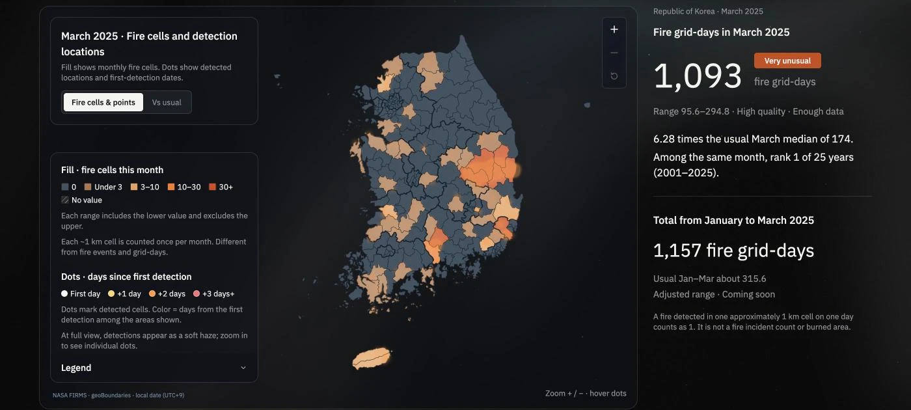
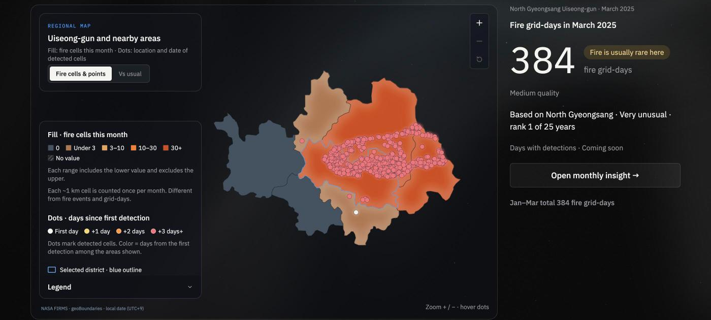
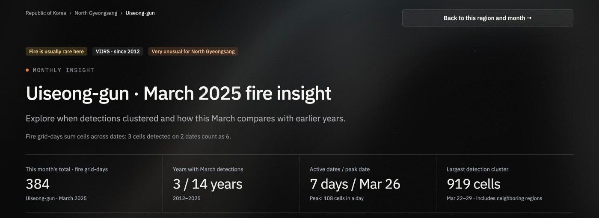

# Hwaruruk 🔥 — Backend API

**Live web app:** [hwaruruk.unzipp.cloud](https://hwaruruk.unzipp.cloud/en)
**Live API:** `https://burnline-api.unzipp.cloud/api/v1/{region}/…` · try [`/KOR/meta`](https://burnline-api.unzipp.cloud/api/v1/KOR/meta)
**Data package:** [hwaruruk_backend_data.zip](https://github.com/NasaSpaceAppsSeoul/NasaSpaceAppsSeoul_backend/releases/latest/download/hwaruruk_backend_data.zip) (119 MB, FIRMS data through 2026-11-14) · **Data pipeline:** [NasaSpaceAppsSeoul_data](https://github.com/NasaSpaceAppsSeoul/NasaSpaceAppsSeoul_data)

NASA Space Apps Challenge 2026 · #9 Harmonization of MODIS and VIIRS Hot Spots · Team JJYa (Seoul)

## What it does

Satellite fire records break in 2012, when MODIS hands over to VIIRS: joined as-is, the same fires look 2–3× more frequent. Our data pipeline harmonizes 25 years of NASA FIRMS hotspots onto a single NOAA-20 scale. This backend serves that harmonized record so the web app can answer one question for any area: **is this month’s fire activity normal, or unusual?**

**Implemented**

- **Six regions on five continents:** South Korea (`KOR`), California (`CAL`), British Columbia (`BC`), Greece (`GRC`), Chile (`CHL`), New South Wales (`NSW`). 1,114 areas in total, monthly from 2001-01.
- **Monthly series** in fire grid-days (one ~1 km cell on one day) for every country, province and district, with the raw value alongside the harmonized one.
- **“vs. normal” judgement** (`record` · `above` · `normal` · `below`) against the 2001–2025 baseline. Sparse districts borrow their province’s judgement instead of reporting noise.
- **Map, detection clusters and official fire records** for each month, plus a monthly insight page that combines all of them.
- **Validation numbers** (2012 break test, leave-one-year-out error, detection rate by fire size) for the methodology page.
- **Korean and English names** for every area: `label_ko` and `name_en`.

## Try it

```bash
curl "https://burnline-api.unzipp.cloud/api/v1/KOR/series/KOR?from=2025-03&to=2025-03"
```

```json
{"id":"KOR","level":"nat","months":[{"month":"2025-03","value":1093.0,"raw_before":1093.0,"source":"NOAA-20",
 "quality":"high","estimated":false,"status":"final","rank":1,"n":25,"ratio_to_median":6.28}]}
```

March 2025 was South Korea’s highest March in 25 years: 1,093 fire grid-days, 6.28× the usual March.

```bash
curl "https://burnline-api.unzipp.cloud/api/v1/KOR/top?month=2025-03"                                   # top 3 districts
curl "https://burnline-api.unzipp.cloud/api/v1/KOR/insight/91817680B75376031789242?month=2025-03"       # Uiseong wildfire, all 9 cards
curl "https://burnline-api.unzipp.cloud/api/v1/CAL/judgement/52423323B88547646561946?month=2018-11"     # Butte County, Camp Fire
```

### In the web app

Following the March 2025 Uiseong wildfire in South Korea, from country to district to the month itself:

| 1 · Country | 2 · District | 3 · This month |
|---|---|---|
|  |  |  |
| 1,093 fire grid-days, 6.28× the usual March, #1 of 25 years | Fire is usually rare here, so it borrows North Gyeongsang’s label | Peak on Mar 26 (108 cells in a day), one cluster of 919 cells |

## Architecture

```
Browser ── Web app (hwaruruk.unzipp.cloud, Vercel) ── /api/* ──▶ Cloudflare Tunnel (burnline-api.unzipp.cloud)
                                   │  routed by path, Railway private network
          ┌────────────────────────┼─────────────────────────┬──────────────────────┐
     catalog-service        timeseries-service         spatial-service        insight-service
     meta, regions, geo     series, judgement          map, events,           insight, top, landing
                            baseline, export.csv       official fires         (calls the other three)
          └──────── PostgreSQL on Neon (one schema per service, Flyway) ──────┘
```

Heavy computation runs once, offline, in the data pipeline. Each service loads the pipeline output from the data package into its own schema; requests then only read precomputed rows. Responses are cached by data version (ETag), with short cache times for months still in progress.

| Service | Port | Endpoints under `/api/v1/{region}` |
|---|---|---|
| `catalog-service` | 8081 | `/meta` · `/regions?level=&q=` · `/regions/{id}` · `/geo?level=&parent=` |
| `timeseries-service` | 8082 | `/series/{id}?from=&to=` · `/baseline/{id}` · `/judgement/{id}?month=` · `/judgement?month=` · `/export.csv?id=` |
| `spatial-service` | 8083 | `/map?month=&parent=` · `/events?region=&from=&to=` · `/official-fires?region=&month=` |
| `insight-service` | 8084 | `/insight/{id}?month=` · `/top?month=&parent=` · `/landing` |
| `common` | — | errors, codes, validation, cache, ETag, CORS, data loading, inter-service client (retry and circuit breaker) |

Every service also exposes `/health/live`, `/health/ready` and `/metrics`. Errors are `{"code", "message"}` with an HTTP status (`REGION_NOT_FOUND`, `MONTH_OUT_OF_RANGE`, `INVALID_PARAM`, `COUNTRY_NOT_READY`).

**Stack:** Java 21 · Spring Boot 3.5 · Gradle multi-module · PostgreSQL 16 (Neon) · JdbcTemplate · Flyway · Redis (optional) · Railway · Cloudflare Tunnel

## Run locally

**Requirements:** Java 21, Docker (for PostgreSQL), Python 3 (optional, for the spec check).

1. **Get the data package.** Download [hwaruruk_backend_data.zip](https://github.com/NasaSpaceAppsSeoul/NasaSpaceAppsSeoul_backend/releases/latest/download/hwaruruk_backend_data.zip) and unzip it (it unzips to a folder named `hwaruruk_backend_data`). `DATA_DIR` must point to the folder that directly contains `output/`, `boundaries/` and `external/` (unzipping can add one extra folder level). The package’s own `README.md` lists every file.

2. **Start PostgreSQL.**

```bash
docker run -d --name burnline-db -p 5432:5432 -e POSTGRES_DB=burnline -e POSTGRES_USER=burnline -e POSTGRES_PASSWORD=burnline postgres:16
```

3. **Build and run the four services.** On first start Flyway creates the tables and each service loads its schema from the data package (about 20 s for spatial-service, a few seconds for the others).

```bash
./gradlew dist
```

```bash
export DATA_DIR=/path/to/hwaruruk_backend_data
for s in catalog timeseries spatial insight; do java -jar dist/$s-service.jar & done
```

```bash
curl "localhost:8082/api/v1/KOR/series/KOR?from=2025-03&to=2025-03"
```

On Windows (PowerShell), build with `.\gradlew.bat dist`, set `$env:DATA_DIR="C:\path\to\hwaruruk_backend_data"` and start each jar with `Start-Process java -ArgumentList '-jar','dist\catalog-service.jar'`.

4. **Run the tests.** They start an embedded PostgreSQL (no Docker needed), load the real data package and check the responses against the API spec examples (44 tests).

```bash
DATA_DIR=/path/to/hwaruruk_backend_data ./gradlew test
```

5. **Check a running stack against the API spec (optional).** With all four services up, `api-test/spec_test.py` calls every endpoint and writes `api-test/report.md`. Add `--base https://burnline-api.unzipp.cloud` to run the same checks against the live API.

```bash
python3 api-test/spec_test.py --sweep
```

### Environment variables

All have local defaults, so none are required to run on one machine. No secrets are stored in this repository.

| Variable | Default | Purpose |
|---|---|---|
| `DATABASE_URL` | `jdbc:postgresql://localhost:5432/burnline` | PostgreSQL connection |
| `DATABASE_USER` / `DATABASE_PASSWORD` | `burnline` / `burnline` | Local development only; set your own in deployment |
| `DATA_DIR` | `../../burnline_backend_data/burnline_backend_data` | Data package folder (the one containing `output/`) |
| `DATA_LOAD` | `if-empty` | `if-empty`, `always` (reload) or `never` (production) |
| `CACHE_URL` | `redis://localhost:6379` | Optional; without Redis only caching is off |
| `CORS_ORIGINS` | `http://localhost:*` | Allowed web origins |
| `CATALOG_URL` / `TIMESERIES_URL` / `SPATIAL_URL` | `http://localhost:8081` / `8082` / `8083` | Used by insight-service |
| `SERVER_PORT` | 8081 / 8082 / 8083 / 8084 | Per service |
| `TUNNEL_CREDS` | — | Deployment only: Cloudflare Tunnel credentials for the `deploy/railway/cloudflared` container |

## Deployment

The live API runs on Railway with its database on Neon (serverless PostgreSQL): one container per service (`deploy/railway/<service>/Dockerfile`, built from `./gradlew dist`) and one Cloudflare Tunnel container that routes each path to its service over Railway’s private network (`deploy/railway/cloudflared/config.yml`). Tunnel credentials come from the `TUNNEL_CREDS` variable and are never committed. An alternative Fly.io setup is described in `deploy/DEPLOY_FLYIO.md`.

**Data is loaded outside the containers.** The images contain only the jar, and production runs with `DATA_LOAD=never`, so redeploying new code does not change what is already in the database. After a new data package, or a code change that affects what a loader writes, reload the affected schema once from a machine that has the package:

```bash
./gradlew dist
```

```bash
DATABASE_URL=<production JDBC URL> DATABASE_USER=<user> DATABASE_PASSWORD=<password> \
DATA_DIR=/path/to/hwaruruk_backend_data SERVER_PORT=18083 \
java -jar dist/spatial-service.jar --spring.profiles.active=load
```

The `load` profile reloads all six regions and exits. Check the log for one `loaded <REGION> in … ms` line per region; `data dir not found` means `DATA_DIR` is wrong and nothing was loaded (exit code 1). Use the matching jar (`catalog`, `timeseries` or `spatial`) for the schema you need to reload; insight-service has no schema. spatial-service holds the most data (satellite detections for all six regions), so check the database plan’s storage limit before reloading it.

## Limitations and unfinished work

- **Data snapshot:** FIRMS data through 2026-11-14. Refreshing means rerunning the pipeline, publishing a new data package and reloading the schemas; daily automatic NRT updates are not built yet.
- **What the numbers mean:** fire grid-days measure fire activity, not burned area or fire counts, and include prescribed and agricultural burns.
- **Before 2012:** values are estimates converted from MODIS. Districts are judged from 2012 onward.
- **External validation:** BC and Greece are marked inconclusive because their official records changed definition over time.
- **Boundaries:** South Korean provinces use geoBoundaries, which predates Gunwi County joining Daegu in 2023.
- **`/top` labels for Greece and Chile:** the live `label_ko` still starts with the province ID (for example `Ipeiroy 지로스` instead of `에페이로스 주 지로스`). The fix is in this repository and the database already holds the Korean names, but the deployed spatial-service has not been rebuilt yet. The web app is not affected: it takes area names from `/regions`.

## Data sources

| Source | Used for | Link |
|---|---|---|
| NASA FIRMS active fire (MODIS C6.1; VIIRS C2: S-NPP, NOAA-20, NOAA-21) | All fire values | [FIRMS download](https://firms.modaps.eosdis.nasa.gov/download/) |
| Korea Forest Service · KOSIS | Korea validation | [Korea links] |
| CAL FIRE FRAP California Fire Perimeters | California validation | [data.gov](https://catalog.data.gov/dataset/california-fire-perimeters-all) |
| BC Wildfire Service historical incidents | BC validation | [BC Data Catalogue](https://catalogue.data.gov.bc.ca/dataset/fire-incident-locations-historical) |
| Hellenic Fire Service forest fire records | Greece validation | [Internet Archive copy](https://web.archive.org/web/20260123051753/https://www.fireservice.gr/el/synola-dedomenon) |
| CONAF statistics and per-fire records | Chile validation | [CONAF](https://www.conaf.cl/centro-documentals/estadisticas-historicas/) · [doi:10.71578/UXAUN5](https://doi.org/10.71578/UXAUN5) |
| NSW NPWS Fire History | NSW validation | [data.gov.au](https://www.data.gov.au/data/dataset/nsw-fire-history-wildfires-and-prescribed-burns-1e8b6) |
| geoBoundaries (CC BY 3.0/4.0), BC Data Catalogue (OGL–BC) | Area boundaries | [geoBoundaries](https://www.geoboundaries.org/) |

AI tools: Claude was used for writing and reviewing code and documentation.
